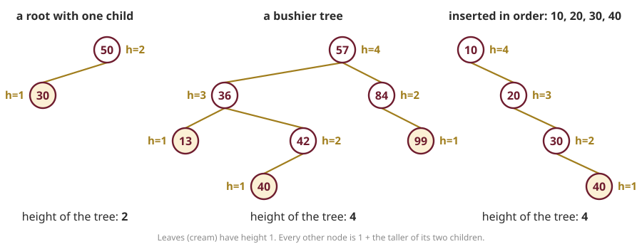
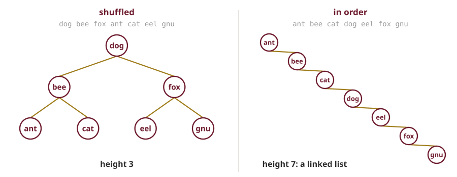

```{=html}
<a class="lab-open-btn" href="../../slides/lab-opening-w11.html?fs=1"
   target="_blank" rel="noopener">
  <span class="lab-open-ico">&#9654;</span>
  Lab opening &middot; Week 11
  <span class="lab-open-sub">full screen</span>
</a>
```

::: {.callout-note}
Your own private GitHub repository is waiting for you (see
[Getting the code](#getting-the-code) below), clone it and open it in VS Code.

**Plan to set aside about 3 hours.** The tree (§4, TODOs 1 to 5) is most of it.
TODOs 6 to 8 are short once the tree works. Do not rush `findings.txt` (§8).
:::

## Objectives

By the end of this assignment, you will be able to:

- State the binary search tree property and explain why a search in a BST is
  fast
- Write `insert`, `contains` and `getHeight` as recursive functions
- Write the inorder and postorder traversals, and explain why inorder prints
  the items in sorted order
- Count words with a `std::map` and compare it with your BST
- Measure the height of BSTs built from random words and compare it with
  `lg(N)`
- Show how inserting sorted data turns a BST into a linked list
- Estimate the constant `a` in `a·lg(N) + b` from your own measurements

---

This assignment covers skills **F1** (implement BST insertion and traversals)
and **G1**/**G2** (use the STL containers), from clusters **F** and **G**.

::: {.callout-important}
**Window 2's reference date is Friday of this week, Nov 20.** You are preparing
for a check-in in the same week you do this, so this assignment is shorter than
usual.
:::

::: {.callout-note}
**Lab and homework.** You start this in lab on **Tuesday Nov 17**, with
Monday's lecture on the BST property and `insert` behind you. §4's TODOs 1–3
need only Monday.

TODO 7 uses `std::map`, which is **Friday's** lecture. You can do it before
then: §5 and the comment in `Index.cpp` give the steps.

**There is no `remove` in this assignment.** We write it together in
Wednesday's lecture.
:::

---

## 1. Introduction

A binary search tree keeps one rule at every node. The items in its left
subtree are smaller than it, and the items in its right subtree are larger.
That rule is the **binary search tree property**, and it gives you two things.

- Searching is fast. At each node you compare once and go left or right, and
  in a well-shaped tree that drops about half of what is left.
- The items are already in order. Visit the left subtree, then the node, then
  the right subtree, and the items come out sorted, with no sorting code.

You will use both. Then you will measure how tall your trees get. The height of
a BST depends on the order the items were inserted in, and a search is only as
fast as the tree is short.

---

## 2. Getting the Code {#getting-the-code}

Your private GitHub repository for this assignment is created for you inside
the course organization, with the starter code already in it. There is nothing
to accept and nothing to set up. If you are on the roster, it is there.


```bash
gh repo clone 26fa-cs112/cs112-a14-YOURUSERNAME
cd cs112-a14-YOURUSERNAME
make
./a14
make test
```

::: {.callout-note}
**Cannot find your repository?**

If `gh repo clone` answers `Could not resolve to a Repository`, list the
repositories you can see:

```bash
gh repo list 26fa-cs112
```

If yours is in the list, you mistyped the name. Copy it from the output and try
again. Usernames that already contain a hyphen or a number are the easy ones to
get wrong, because the pattern is `cs112-<assignment>-<your username>`.

**If the list is empty, or the command errors, email me.** The usual causes are
an organization invitation you have not accepted yet (check your email,
including spam and the Promotions tab), or a username I mistyped when I built
the roster. Write to [eric.araujo@calvin.edu](mailto:eric.araujo@calvin.edu)
and I will sort it out the same day.

While you wait, **do not create a repository yourself and do not start the work
somewhere else.** Only the repository I create for you is connected to grading,
and work done anywhere else has to be moved over by hand.
:::

`make` succeeds, with one warning that `myNumItems` is used uninitialized until
you write TODO 1. `./a14` stops and tells you to do TODOs 1 and 2, and
`make test` reports **1 / 36**.

---

## 3. What You Were Given

**You edit three files: `BST.h`, `Index.cpp` and `findings.txt`.** Nine TODOs.

| File | Yours? | What it is |
|---|---|---|
| `BST.h` | **yes** | the tree, TODOs 1–5 |
| `Index.cpp` | **yes** | TODOs 6–8 |
| `findings.txt` | **yes** | TODO 9, the four questions |
| `Index.h` | no | the specification. Read this first. |
| `given.cpp` | no | file loading, the sampler, the statistics, the chart |
| `main.cpp` | no | runs all four parts |
| `Exceptions.h` | no | `BSTException` |
| `fieldnotes.txt` | no | the text you index |
| `words.txt` | no | a11's dictionary, already sorted |
| `Timer.h` | no | a09's stopwatch |
| `checks.cpp` | no | the course's checks. Read them: they are the specification. |

Do not edit the files marked *no*. Grading puts back its own copies of all of
them, so a change there cannot change your score. `make test` also checks
several of them against their original versions and tells you if one has
changed.

::: {.callout-note}
**Header-only.** `BST` is a class template, so its definitions live in
`BST.h` below the class, as with `Trace` in a06,
`List` in a08, and `Stack` and `Queue` in a10. There is no `BST.cpp`.
:::

### What `BST.h` already has

- **The destructor.** `~Node` deletes its two children, and each of them deletes
  its own children, and so on down. So one `delete myRoot` in `~BST` frees the
  whole tree, the same idea as a08's `List`. Deleting a `nullptr` does nothing,
  which is why there is no `if` before each `delete`.
- **`isEmpty()` and `getSize()`.**
- **`processItem(out)`**, what a traversal does with each item: it writes the
  item and a space to the stream `out`. Every traversal writes to the `out` it
  is given, which is how the checks can pass a `stringstream` and read back what
  your traversal produced.
- **`traversePreorder`**, on `BST` and on `Node`, the model for TODO 5.

### Every operation is written twice

```
BST::insert     handles the empty tree, keeps the count, and otherwise
                calls insert on the root node
Node::insert    the recursive one, decides left or right, and either
                recurses or attaches a new Node
```

{#fig-two-classes fig-alt="On the left, a box for the BST object with two fields, myRoot and myNumItems equal to 5; myRoot points to the root node. On the right, five Node objects for 57, 36, 84, 13 and 42, each drawn as a box with the item on top and two cells under it, myLeft and myRight. 57 points left to 36 and right to 84; 36 points left to 13 and right to 42; 84, 13 and 42 have slashes in both cells, meaning nullptr."}

`contains`, `getHeight` and the traversals are split the same way: the `BST`
version handles the empty tree, and the `Node` version does the recursion.

---

## 4. TODOs 1 to 5, the tree {#the-tree}

**TODO 1, the constructor, `BST()`.** A new tree is empty: it has no root node
and holds no items. Set `myRoot` to `nullptr` and `myNumItems` to 0.

**TODO 2, `insert`.** Two functions, as §3 explains.

`BST::insert(it)`:

1. If the tree is empty, make the root: `myRoot = new Node(it);`
2. Otherwise, let the root do it: `myRoot->insert(it);`
3. Then add 1 to `myNumItems`.

`Node::insert(it)` compares `it` with `myItem`:

- `it < myItem`: it belongs on the left. If `myLeft` is `nullptr`, attach a new
  node there with `myLeft = new Node(it);`. Otherwise call
  `myLeft->insert(it);`.
- `it > myItem`: the same on the right, with `myRight`.
- Otherwise the item is already in the tree, so **throw**:
  `throw BSTException("insert()", "item is already in the tree");`

`Item` only needs `<` and `>`, so the same code works for `int` and for
`string`.

{#fig-insert fig-alt="Two copies of the tree 57 with children 36 and 84, and 13 under 36. Left panel, insert(42): the path from 57 to 36 is highlighted, labeled 42 less than 57 go left, then 42 greater than 36 and myRight is nullptr; a new node 42 is attached as 36's right child, labeled new Node(42), a leaf. Caption: myNumItems goes up after the call returns. Right panel, insert(36): the path from 57 to 36 is highlighted and 36 is outlined in red, labeled 36 equals 36, already here, throw BSTException. Caption: nothing is added, and myNumItems does not change."}

::: {.callout-note}
**Why throw on a duplicate?** A second copy of a value has no place to go in the
tree, because it is neither less than nor greater than itself. `insert` could
ignore it quietly, but then the caller would not know the value was already
there.

This assignment needs to know. §5's index counts repeated words, and §7's
experiment counts duplicate draws, by counting how often `insert` throws.

```cpp
try {
    tree.insert(word);
    ++distinct;
} catch (BSTException&) {
    ++repeats;
}
```
:::

::: {.callout-warning}
`BST::insert` must count **after** the recursive call, not before. `Node::insert`
throws when the item is already there, and a refused insert must not make the
tree think it grew.
:::

**TODO 3, `contains`.** The same walk as `insert`, but it changes nothing.

- `BST::contains(it)`: if the tree is empty, return `false`. Otherwise return
  `myRoot->contains(it)`.
- `Node::contains(it)`: if `it == myItem`, return `true`. If `it < myItem`,
  return `false` when there is no left child, and otherwise return
  `myLeft->contains(it)`. If `it > myItem`, do the same on the right.

**Write `return` in front of each recursive call:** `return myLeft->contains(it);`.
Without it, the answer the child found is thrown away, and the function reaches
its end without returning a value.

**TODO 4, `getHeight`.** Heights here count **nodes**, not edges:

| | |
|---|---|
| an empty tree | 0 |
| one node | 1 |
| a root with one child | 2 |

A node's height is one more than the taller of its two subtrees:

- `BST::getHeight()`: an empty tree has height 0. Otherwise return
  `myRoot->getHeight()`.
- `Node::getHeight()`: work out the height of the left subtree, which is 0 if
  `myLeft` is `nullptr` and `myLeft->getHeight()` otherwise. Do the same for the
  right. Return 1 plus the larger of the two.

A leaf then gets 1 + 0 = 1 with no special case. You cannot call
`getHeight()` on a `nullptr`, which is why each child is checked before you ask
it.

{#fig-heights fig-alt="Three binary search trees side by side, each node labeled with its height. Left, a root with one child: 50 with height 2, and its left child 30 with height 1; the tree's height is 2. Middle, a bushier tree: 57 with height 4; its left child 36 with height 3, whose children are 13 with height 1 and 42 with height 2, and 42 has a left child 40 with height 1; 57's right child 84 has height 2 and its right child 99 has height 1; the tree's height is 4. Right, 10, 20, 30, 40 inserted in order, a chain going right: 10 has height 4, 20 has 3, 30 has 2 and 40 has 1; the tree's height is 4."}

Every height in §7 comes from this method. Check it against a tree you have
drawn on paper before you trust it.

**TODO 5, the two traversals.** `traversePreorder` is written for you, on
`BST` and on `Node`. Read both. `BST::traversePreorder` asks the root to start
if the tree is not empty, and `Node::traversePreorder` does three things: it
processes its own item with `processItem(out)`, then calls the left child, then
the right child, each only if it is not `nullptr`.

Write `traverseInorder` and `traversePostorder` the same way, on both classes.
Copy the preorder code and change the order of the three steps:

```
pre-order    me, left, right
in-order     left, me, right
post-order   left, right, me
```

{#fig-traversals fig-alt="The tree 57, with children 36 and 84; 36 has children 13 and 42; 84 has children 63 and 99. It is drawn three times. Preorder visits 57, 36, 13, 42, 84, 63, 99 and prints 57 36 13 42 84 63 99. Inorder visits 13, 36, 42, 57, 63, 84, 99 and prints them in sorted order. Postorder visits 13, 42, 36, 63, 99, 84, 57."}

::: {.callout-note}
**Why in-order comes out sorted.** Everything to the left of a node is smaller
and everything to the right is larger, so walking left, then me, then right
visits the items in ascending order.

Your index prints alphabetically without any sorting code.
:::

---

## 5. TODOs 6 and 7, index a text, twice {#the-index}

**TODO 6, `indexText(words, tree)`.** Put every word into the tree and count.
The words come from `wordsIn` in `given.cpp`: every word of `fieldnotes.txt`,
lower-cased, with anything that is not a letter treated as a space, so `don't`
becomes `don` and `t`.

1. Loop over `words`. For each word, `insert` it into `tree` inside a `try`.
2. If the insert succeeds, the word is new: add 1 to `report.distinct`.
3. If it throws a `BSTException`, the word was already there: catch it and add
   1 to `report.repeats`.
4. Set `report.total` to the number of words you looked at, which is
   `distinct + repeats`, and return `report`.

`main.cpp` then prints the tree with an in-order traversal, in alphabetical
order.

**TODO 7, `indexWithMap(words)`.** The same job with a `map<string, int>`,
about five lines. Loop over `words` and, for each one, do

```cpp
counts[word]++;
```

then return `counts`. If `word` is not a key yet, `counts[word]` adds it with
the value 0, and `++` makes it 1. If it is already a key, `++` adds one to its
count.

::: {.callout-important}
**What the map does that your tree does not.**

Your `BST<string>` is a **set**. It remembers *which* words appeared, and
catching the exception is the only way to learn that one appeared twice.

A `map` is a set with a **value attached to every key**, so it can hold the
count itself. That is the difference between `std::set` and `std::map`,
and it is Friday's lecture.

A `map` also iterates in key order, for the same reason your in-order traversal
does. Inside, it is a balanced binary search tree, usually a red-black tree.
:::

---

## 6. TODO 8, one trial

**TODO 8, `runTrial(sample)`.** Build a fresh tree from `sample` and report how
tall it came out.

1. Declare a local `BST<string>`.
2. Call your `indexText` with `sample` and that tree. It returns an
   `IndexReport` with the distinct words and the repeats.
3. Fill in `result.height` from the tree's `getHeight()`, and copy `distinct`
   and `repeats` from the report. Return `result`.

Make the tree a local variable so its destructor frees it. `main.cpp` runs this
ten times on twenty thousand words each.

---

## 7. The experiment {#the-experiment}

Run `./a14` and look at what it prints. It also writes `results.html`, a chart
of the ten heights against `lg(N)` and the two heights from the insertion-order
test.

Your files are on the Coder server and your browser is on your laptop, so
double-clicking `results.html` only shows you its source. Serve the folder
instead, from your repository folder:

```bash
python3 -m http.server 8000
```

Then open `http://localhost:8000/results.html`. VS Code forwards the port for
you.

### Ten trees from random samples

Ten times, the program draws 20,000 words at random from the dictionary, **with
replacement**, so the same word can come up twice, and builds a tree. On a
typical run:

```
   trial   height   distinct   duplicates
       1       36      17605         2395
       2       33      17531         2469
       ...
   smallest 31   largest 36   mean 33.40   median 33.00   stdev 1.85
   lg(N) for N = 17516 is 14.10
   duplicates per trial, on average: 2483
```

About 17,500 distinct words, in a tree of height about **33**. A perfectly
balanced tree of that many words would have height 15.

::: {.callout-note}
**Why the experiment gives the same answer on every machine.** The sampler in
`given.cpp` is a linear congruential generator with a fixed seed, the same one
a13's snake uses. It is a poor source of randomness, but it is repeatable. Every
machine draws the same words, so every correct tree has the same height, and the
grader can check it. Random draws would give a different height on every run.
:::

### The same words, two orders

Then the program takes 5,000 words and inserts them twice: shuffled, and in the
order they already sit in `words.txt`, which is alphabetical.

```
   shuffled first:      height 30
   already in order:    height 5000
   lg(5000) is 12.29
```

Height 5,000. Each word is greater than the one before it, so each new word goes
to the right of the last one. The tree is a linked list.

{#fig-shapes fig-alt="Left, the words dog, bee, fox, ant, cat, eel, gnu inserted in that order: dog at the root, bee and fox under it, and ant, cat, eel, gnu as leaves; height 3. Right, ant, bee, cat, dog, eel, fox, gnu inserted in alphabetical order: each word is the right child of the one before, a diagonal chain; height 7, a linked list."}

Then it looks up the same word in each. Your times will differ from these, but
the gap will be about as large:

```
   looking up "barrier":
     in the shuffled tree:   0.031 microseconds
     in the sorted tree:     16.549 microseconds
     the shape cost you a factor of 533.1.
```

::: {.callout-important}
**The code is correct.** Every node still keeps the BST property.

The tree is slow because of its shape, and its shape comes from the order the
words were inserted, which the tree does not control. Sorted input is common, and
`words.txt` itself is sorted.
:::

::: {.callout-note}
## Next week: keeping the tree balanced

You can deal with this in two ways. One is to measure the height of the trees
your program builds, on your real data, which is what this assignment does. The
other is to change `insert` so that it keeps the tree balanced whatever order
the items arrive in. That takes *rotations*, next week's topic.
:::

::: {.callout-warning}
**Why 5,000 and not all 73,419.** Inserting the whole sorted dictionary into an
unbalanced tree is about 2.7 billion comparisons, and it would hang. At 5,000
the tree already has height 5,000, and building it takes noticeably longer
than the shuffled one.
:::

---

## 8. TODO 9, `findings.txt` {#findings}

Fill in `findings.txt` after you run `./a14`. First copy three numbers from
what your program printed:

- `mean-height`: the mean of the ten trial heights (the `mean` on the
  statistics line)
- `sorted-height`: the height of the tree built from the words in order (the
  `already in order` line)
- `duplicates-per-trial`: the line `duplicates per trial, on average`

The grader checks the first two against what your own program printed. Then
answer these four questions in the same file:

1. Is `lg(N)` or `N` a better approximation for your measured heights? Why?
2. How much variance is there in the ten heights? Is that surprising?
3. How many duplicate values were there on average? Is that surprising?
4. Big-Oh `O(f(n))` implies constants `a` and `b` such that `a·f(n) + b`
   describes the reality it approximates. A balanced BST of N items has height
   `O(lg N)`. **Using your experimental results, what is a reasonable value for
   `a`?**

::: {.callout-important}
**About question 4.** Big-Oh drops the constants. Knowing that the height is
`O(lg N)` does not tell you whether a tree of 17,500 words is 14 or 140 tall.
You have measured both `lg(N)` and the height you got, so dividing the height
by `lg(N)` gives you a value for `a`.
:::

Two of the four are also checked for a fact. **Answer 1 must start with `lg` or
`N`**, whichever fits your heights, and only the one that fits passes. **Answer 4
must start with your value for `a`, as a number**, and it has to be a value
your heights support. Each of the four answers needs at least twenty words. The
writing itself is not graded.

---

## 9. Testing Your Work

```bash
make test         # all 36 checks
```

To run the course's checks yourself, or one of them by name while you work on
it:

```bash
make checks
./checks "Tree: an in-order traversal comes out sorted"
```

Each check runs in its own process, so a recursion that never stops costs you
that one check, not the whole run.

::: {.callout-important}
**There are no hidden tests.** What you run with `make test` is exactly what the
grader runs, all 36 checks, every one of them in a file in your repository.
:::

| | |
|---|---|
| 6 | the tree, insert, contains, duplicates |
| 5 | height |
| 5 | the three traversals |
| 7 | the index and the map |
| 4 | the experiment |
| 5 | the program runs, and `results.html` |
| 4 | `findings.txt` |

**Heights are graded exactly. Microseconds are not graded at all.** A height is
a fact about the data and the order it arrived in, the same on every machine.
Your timings are a fact about your laptop at that moment. Same rule as a09.

The check named *"Trial: a sorted sample collapses to a height equal to its
size"* is exact: N sorted items must give a tree of height N, for several values of N.

---

## 10. Submit

```bash
git add .
git commit -m "Complete a14"
git push
```

`findings.txt` must be committed. `results.html` need not be.

::: {.callout-important}
Put your name at the top of `README.md` before your final push.
:::

Push as often as you like. The most recent push counts, and the only deadline is
the last day of classes.

---

::: {.callout-note}
## Six containers

You have now built six containers by hand: a growing array, a linked list, a
stack, a queue, a hash table and a binary search tree.

None of them is fast at every operation. Measuring is how you check that you
picked the right one.

Next week you make the tree keep itself balanced. The last assignment after
that is not about containers.
:::
